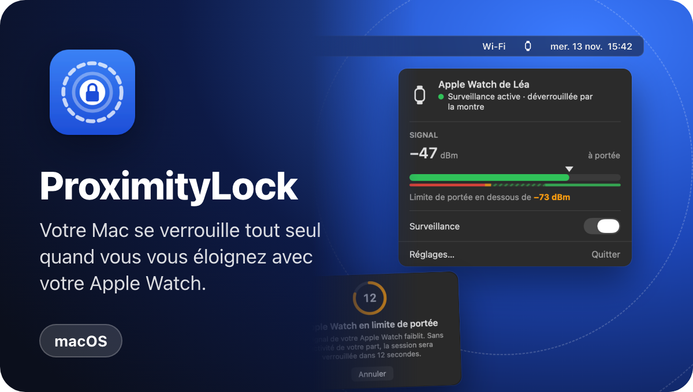
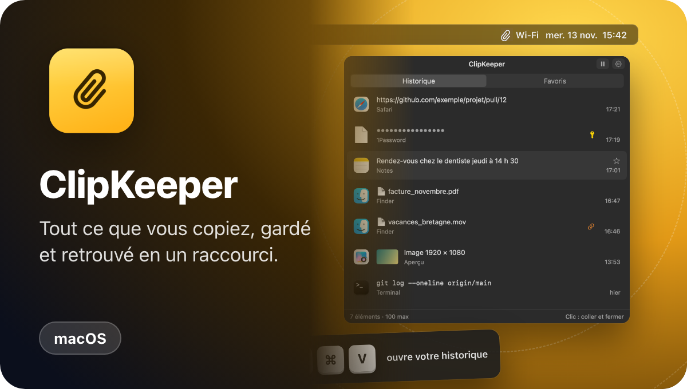
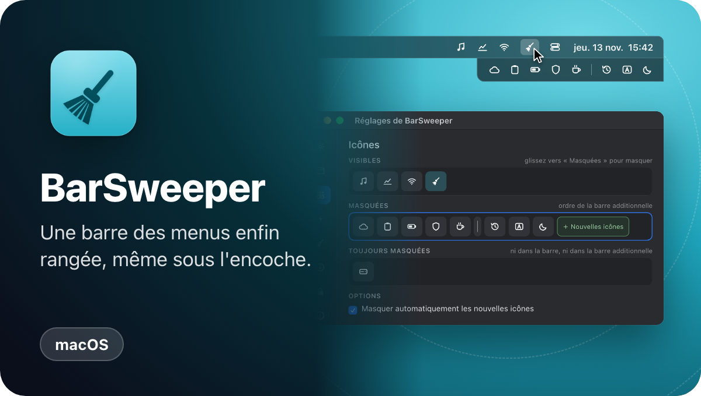
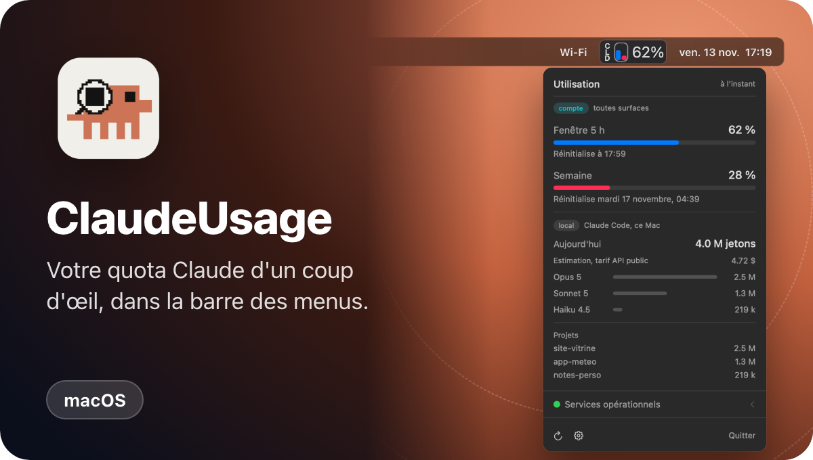
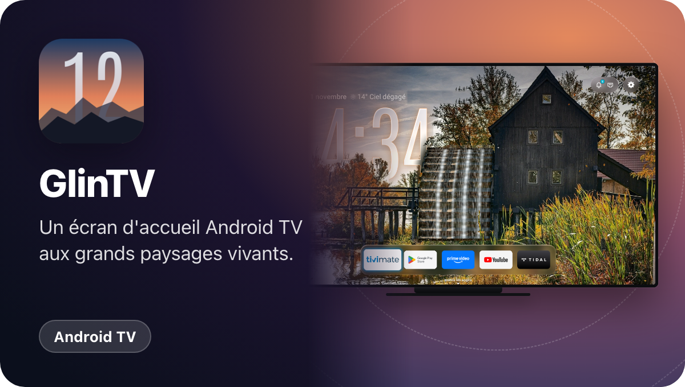

De petites apps soignées pour le Mac et la TV, imaginées par un humain et construites avec une IA. 
Signées, et qui se mettent à jour d'elles-mêmes.

<a href="https://noktualabs.github.io"><b>→ Découvrir les apps sur noktualabs.github.io</b></a>

## Pour le Mac

<table>
<tr>
<td width="50%"></td>
<td width="50%"></td>
</tr>
<tr>
<td width="50%"></td>
<td width="50%"></td>
</tr>
</table>

## Pour Android TV

<table>
<tr>
<td width="50%"></td>
<td width="50%"></td>
</tr>
</table>

Chaque carte mène à la page de l'app : captures, fonctionnement, installation et questions fréquentes.
Les apps Mac sont signées par NoktuaLabs et vérifient la signature de chaque mise à jour avant de l'installer.
