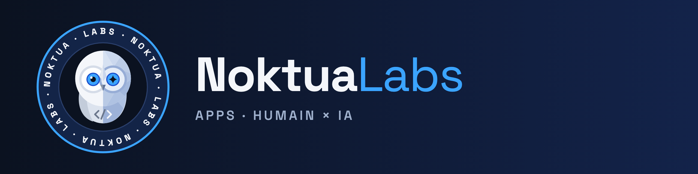

## macOS

| App | Ce qu'elle fait | Télécharger |
|---|---|---|
| **BarSweeper** | Range les icônes de la barre des menus : masquage, barre additionnelle, réglage à part pour l'écran à encoche. | [Dernière version](https://github.com/NoktuaLabs/BarSweeper-releases/releases/latest) |
| **ClipKeeper** | Garde l'historique du presse-papiers et le rend à portée de raccourci. | [Dernière version](https://github.com/NoktuaLabs/ClipKeeper-releases/releases/latest) |
| **ProximityLock** | Verrouille la session quand l'Apple Watch s'éloigne du Mac. | [Dernière version](https://github.com/NoktuaLabs/ProximityLock-releases/releases/latest) |
| **ClaudeUsage** | Affiche la consommation de Claude dans la barre des menus. | [Dernière version](https://github.com/NoktuaLabs/ClaudeUsage-releases/releases/latest) |

Les apps sont signées et se mettent à jour d'elles-mêmes, en vérifiant la signature de chaque nouvelle version.

## Android

| App | Ce qu'elle fait | Télécharger |
|---|---|---|
| **GlinTV** | Écran d'accueil pour Android TV : grands fonds photo renouvelés, horloge qui passe derrière le relief. | [Dernière version](https://github.com/NoktuaLabs/GlinTV-releases/releases/latest) |

GlinTV est signé et peut chercher ses mises à jour chaque jour ; Android demande toujours de confirmer l'installation.
